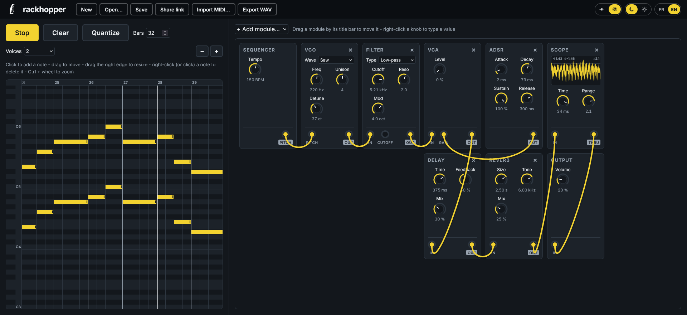

<!-- TODO: check the live URL once the site is deployed. -->

<p align="center">
  
</p>

<h1 align="center">rackhopper</h1>

<p align="center">
  A modular synthesizer playground in the browser.<br />
  Patch modules together with cables, write melodies in a piano roll, and hear the result.
</p>

<p align="center">
  <a href="https://mxncmrchnd.github.io/rackhopper/"><strong>Try it live</strong></a>
</p>



The name is a pun: a rockhopper penguin, hopping around a rack of synth modules.

## Features

- **Modular patching**: drag cables between jacks to connect modules, move modules around
  a grid, add and remove them.
- **Modules**:
  - Sound: VCO (with unison and detune), Filter, VCA, ADSR envelope, LFO
  - Effects: Drive, EQ, Chorus, Delay, Reverb, Compressor
  - Tools: Oscilloscope, Sequencer, Output
- **Polyphony**: up to 8 voices, with polyphonic cables (one cable carries every voice).
- **Piano roll**: draw, move and resize notes, loops from 1 to 64 bars, zoom, quantize.
- **MIDI import**: load a `.mid` file into the piano roll.
- **Audio export**: render the loop to a WAV file, faster than real time.
- **Save and share**: autosave in the browser, save/open project files, or share a project
  as a link.
- **Knobs or sliders**, **light or dark theme**, **English or French**.

## Quick start

Open the [live version](https://mxncmrchnd.github.io/rackhopper/) and press **Play**.
The default patch is a simple pluck: try turning the filter's knobs, or add a Reverb
between the VCA and the Output.

Tips:

- Right-click a knob to type a value; double-click to reset it.
- Drag from a patched input jack to pick up its cable.
- Effects work best at the end of the chain, after the VCA.

## Running locally

Requires [Node.js](https://nodejs.org/) (a recent LTS version).

```sh
npm install
npm run dev
```

Then open <http://localhost:5173/rackhopper/>.

| Command           | What it does                                 |
| ----------------- | -------------------------------------------- |
| `npm run dev`     | Start the development server with hot reload |
| `npm run build`   | Type-check and build the site into `dist/`   |
| `npm run preview` | Serve the built site locally                 |

## How it's built

- **TypeScript** (strict mode) and **Vite**, with no UI framework.
- **Web Audio API** directly: oscillators, filters, gains, convolution, analysers. No audio
  library.
- **Canvas 2D** for the piano roll and oscilloscope, **DOM** for module panels, **SVG** for
  cables.
- Hand-written MIDI file parser and WAV encoder.

The project started as a way to learn TypeScript, so the code favours clarity and is
commented throughout. Good places to start reading:

- `src/modules/synth-module.ts`: the interface every module implements
- `src/patch.ts`: the patch model (modules, cables, polyphony wiring)
- `src/modules/sequencer.ts`: the look-ahead scheduler

### Built with Claude Code

rackhopper was developed with [Claude Code](https://claude.com/claude-code), Anthropic's
AI coding assistant.
The project's conventions and architecture notes, which Claude Code reads at the start
of each session, are in [`CLAUDE.md`](CLAUDE.md).

## Browser support

Developed and tested in Firefox. It should work in any recent browser with Web Audio
support (Chrome, Edge, Safari).

## Deployment

Every push to `main` builds and deploys the site to GitHub Pages
(`.github/workflows/deploy.yml`).

## License

[MIT](LICENSE) © 2026 Maxence Marchand

The Inter font is used under the [SIL Open Font License](https://openfontlicense.org/).
